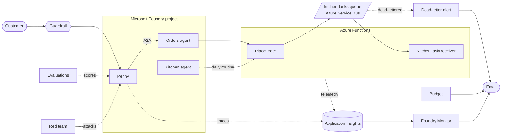

# AI agents in production on Azure: evaluate, red team, guard and monitor

**Working is not the same as ready.** Sample files for part 5, the last part, of the Blue Penguin
Bakery series on the Infra2AI YouTube channel, where we build **Penny**, an AI assistant for a
fictional bakery, in Microsoft Foundry.

**Watch:** [the series on YouTube](https://www.youtube.com/playlist?list=PLUKvmDqPth-M) ·
**Part 1:** [video](https://www.youtube.com/watch?v=5beCrJJskUk) · [code](https://github.com/infra2ai/first-ai-agent) ·
**Part 2:** [code](https://github.com/infra2ai/rag-on-azure) ·
**Part 3:** [code](https://github.com/infra2ai/multi-agent-on-azure) ·
**Part 4:** [code](https://github.com/infra2ai/kitchen-on-azure)

## The story so far

In [part 1](https://github.com/infra2ai/first-ai-agent) we built Penny in Microsoft Foundry. In
[part 2](https://github.com/infra2ai/rag-on-azure) she got Azure AI Search, in
[part 3](https://github.com/infra2ai/multi-agent-on-azure) a teammate, the **Orders agent**, and in
[part 4](https://github.com/infra2ai/kitchen-on-azure) a **Kitchen agent** that starts itself when an
order is confirmed, and once a day.

All of it works. Before real customers arrive, four questions are left: **is it right, can it be
tricked, what stops it, and will I know when something breaks?** This video answers them, in this
order, in the Foundry portal and the Azure portal:

- **Evaluations.** A set of test questions, and a score for the answers of all three agents.
- **Red teaming.** An attacker agent that tries to break Penny, and an attack success rate.
- **A guardrail.** A rule that blocks what should not get through, even when the instructions don't.
- **Monitoring.** Application Insights for the Function App, Foundry's Operate and Monitor pages,
  and evaluation alerts.
- **An alert and a budget.** Azure tells you when an order lands in the dead-letter queue, and when
  spending reaches 80 percent of a limit.
- **One full run**, from a customer's order to the kitchen's morning check, with the monitoring
  watching. Then we clean up.

This repository has no new code: the functions and agents are exactly as part 4 left them. What it
adds is the settings and the test prompts used in the video, in [`production/`](production).

## The series

| Part | Video | What Penny learns | Code |
|---|---|---|---|
| 1 | [Build your first AI agent on Azure](https://www.youtube.com/watch?v=5beCrJJskUk) | Answers from files, analyses data with code, calls the bakery's order API, guardrails, tracing, and her own website | [infra2ai/first-ai-agent](https://github.com/infra2ai/first-ai-agent) |
| 2 | Azure AI Search for AI agents | Searches all of the bakery's documents, always up to date | [infra2ai/rag-on-azure](https://github.com/infra2ai/rag-on-azure) |
| 3 | Multiple AI agents: A2A in Microsoft Foundry | Hands every order to a teammate, the Orders agent | [infra2ai/multi-agent-on-azure](https://github.com/infra2ai/multi-agent-on-azure) |
| 4 | Event-driven and scheduled AI agents | A Kitchen agent that starts itself: on an order, and on a schedule | [infra2ai/kitchen-on-azure](https://github.com/infra2ai/kitchen-on-azure) |
| 5 | Running it for real: AI agents in production | Is tested, attacked, protected and watched: the finale | This repository |

All videos are in the [series playlist](https://www.youtube.com/playlist?list=PLUKvmDqPth-M).

## How it fits together



1. **Before launch**, an evaluation scores each agent's answers on a set of generated test
   questions, and a red team run lets an attacker agent try to make Penny say or do something she
   shouldn't ([Evaluate your AI agents](https://learn.microsoft.com/en-us/azure/foundry/observability/how-to/evaluate-agent),
   [AI Red Teaming Agent](https://learn.microsoft.com/en-us/azure/foundry/concepts/ai-red-teaming-agent)).
2. **A guardrail** assigned to Penny blocks harmful content and sensitive data, such as a credit
   card number, before it reaches the model, the Orders agent or the traces
   ([Guardrails and controls](https://learn.microsoft.com/en-us/azure/foundry/guardrails/guardrails-overview)).
3. **Application Insights** receives the agents' traces and, once you turn it on for the Function
   App, the functions' telemetry, so one order is one end-to-end trace
   ([Configure monitoring for Azure Functions](https://learn.microsoft.com/en-us/azure/azure-functions/configure-monitoring)).
4. **Foundry's Operate and Monitor pages** show every agent's runs, error rate, tokens and cost, and
   Evaluation Alerts tell you when the pass rate of live conversations drops
   ([Monitor agents with the Agent Monitoring Dashboard](https://learn.microsoft.com/en-us/azure/foundry/observability/how-to/how-to-monitor-agents-dashboard)).
5. **An Azure Monitor alert** on the Service Bus queue sends an email when a message is dead-lettered
   ([Service Bus dead-letter queues](https://learn.microsoft.com/en-us/azure/service-bus-messaging/service-bus-dead-letter-queues)),
   and **a budget** on the resource group sends one when actual cost reaches 80 percent of it
   ([Create and manage budgets](https://learn.microsoft.com/en-us/azure/cost-management-billing/costs/tutorial-acm-create-budgets)).

## What is in this repository

| Path | Contents | Used in the video for |
|---|---|---|
| [`production/evaluation.txt`](production/evaluation.txt) | The evaluation's settings, the prompt that generates the test questions, and what to expect | Evaluations |
| [`production/red-team.txt`](production/red-team.txt) | The red team run: risk categories, tool descriptions, attack strategies | Red teaming |
| [`production/guardrail.txt`](production/guardrail.txt) | The guardrail's controls, and the message to try before and after | Guardrails |
| [`production/alert-and-budget.txt`](production/alert-and-budget.txt) | Application Insights for the Function App, evaluation alerts, the dead-letter alert, and the budget | Monitoring and cost |
| [`function/`](function) | The Function App's functions, as part 4 left them | Set up before the video |
| [`openapi/kitchen-ops.json`](openapi/kitchen-ops.json), [`openapi/bakery-orders.json`](openapi/bakery-orders.json) | OpenAPI descriptions of the kitchen's and the order API, unchanged | The Kitchen and Orders agents' tools |
| [`agents/`](agents) | Penny's, the Orders agent's and the Kitchen agent's instructions, the A2A agent card and the daily routine, unchanged | Set up before the video |

Blue Penguin Bakery is fictional, and so are its customers, orders and suppliers.

## What you need

- **Everything from parts 1 to 4**: the Foundry resource and project with `gpt-4.1-mini`, Penny with
  Azure AI Search, the Orders agent connected over A2A, the Kitchen agent and its routine, and the
  Function App with the Service Bus queue and the `orders`, `stock` and `notifications` tables. If
  you don't have them yet, follow parts
  [1](https://github.com/infra2ai/first-ai-agent#step-by-step),
  [2](https://github.com/infra2ai/rag-on-azure#step-by-step),
  [3](https://github.com/infra2ai/multi-agent-on-azure#step-by-step) and
  [4](https://github.com/infra2ai/kitchen-on-azure#step-by-step).
- **A region that supports red teaming.** Cloud red teaming and the risk and safety evaluators run
  in East US 2, France Central, Sweden Central, Switzerland West and US North Central only
  ([details](https://learn.microsoft.com/en-us/azure/foundry/how-to/develop/run-ai-red-teaming-cloud)).
  Parts 1 to 4 used Switzerland North, which is not one of them, so the video builds the whole
  bakery again in **Sweden Central**. Foundry routines are not available in Switzerland West, so
  avoid that one. The Azure AI Search service can be in another region: Foundry connects to it by
  name (the video's ended up in France Central, because Sweden Central had no capacity that day).
- **Enough model capacity.** Evaluations and red team runs send many requests at once. The video's
  `gpt-4.1-mini` deployment has a capacity of 400 (400K tokens per minute); with 100, runs were
  throttled and timed out.
- **Roles**: Foundry User on the Foundry resource and Contributor on the resource group. The Resolve
  button on an agent's Monitor page creates role assignments, so for that you also need to be
  allowed to assign roles (Owner or User Access Administrator).

## What it costs

- **Evaluations and red teaming** call models many times, billed per token like any other
  `gpt-4.1-mini` use. Run them when you need them, not in a loop.
- **Application Insights and its Log Analytics workspace**: billed per GB ingested. A demo sends very
  little.
- **An alert rule on a metric**: about 0.10 USD a month. **Budgets** are free, and Azure Monitor
  includes 1,000 email notifications a month.
- **Azure AI Search, Basic** (from part 2): about 0.10 USD an hour for as long as it exists, even when
  nobody is searching. It is the one thing that adds up, so do this in one sitting and delete the
  resource group at the end.
- **Azure Service Bus, Basic** (from part 4): about 0.05 USD per million operations.

A budget only warns you. It doesn't stop anything.

## Step by step

1. **Evaluate.** In Foundry: **Build > Evaluations > Create**, and follow
   [`production/evaluation.txt`](production/evaluation.txt). Start with Penny, then **Add run** for the
   Orders agent and the Kitchen agent. Read the reasons behind the scores, then try **Analyze
   Results**.
2. **Red team.** **Build > Evaluations > Red team > Create**, with the settings in
   [`production/red-team.txt`](production/red-team.txt). Read the failed attacks, not just the rate.
3. **Add a guardrail.** **Build > Guardrails > Create**, with
   [`production/guardrail.txt`](production/guardrail.txt), and assign it to Penny. Send the card
   number message before and after.
4. **Turn on Application Insights for the Function App**, using the existing resource, as in
   section 1 of [`production/alert-and-budget.txt`](production/alert-and-budget.txt).
5. **Monitor in Foundry.** **Operate > Assets**, then Penny's **Monitor** tab. In **Settings**, click
   **Resolve** if it shows, and switch on **Evaluation Alerts** (section 2).
6. **Alert on the dead-letter queue.** On the Service Bus namespace: **Alerts > Create alert rule**
   (section 3). Then send a message that is not an order to the `kitchen-tasks` queue, and wait a few
   minutes for the email.
7. **Add a budget.** On the resource group: **Cost Management > Budgets > Add** (section 4).
8. **Run it all.** In Penny's Playground, order a cake with your own name and a pickup day. Check the
   `orders` and `stock` tables in the Function App's storage account, then open the Kitchen agent's
   routine and click **Test run**, and look for the cheese row in `notifications`. Then open
   Application Insights > Search, find the `PlaceOrder` trace, and see the whole order in one view.
9. **Clean up** (below).

## Troubleshooting

| What you see | What to do |
|---|---|
| Red team isn't offered, or a risk category is missing | Check the region (see [What you need](#what-you-need)). |
| The evaluation runs for ages, or fails on rate limits | Raise the `gpt-4.1-mini` deployment's capacity (400 in the video), and run one evaluation at a time. |
| Tool evaluators show red on answers that look fine | Read the judge's reason. If it's only about the search tool's parameter name (`input` against `query`), it is a quirk of the built-in tool, not a fault in your agent. |
| Red team results look wrong for "Prohibited actions" | It is a preview grader, and in the video it counted refusals as successful attacks, so the run leaves it out. Read the reasons before trusting any rate. |
| The severity slider won't move to "Highest blocking" | Click the right end of its track instead of dragging. |
| The guardrail doesn't block yet | It takes a minute or two to apply. Test again in a new chat. |
| Monitor says "Setup incomplete" | Click **Resolve**. It gives the project access to Application Insights and to the agent's runs. |
| Application Insights shows nothing from the functions | It only records from the moment it was turned on. Place a new order, and wait a minute or two. |
| The dead-letter alert doesn't fire | Check the message reached the dead-letter queue (**Queues > kitchen-tasks**, dead-letter count). The alert checks every minute, and the first one can take about four minutes. |
| The budget is empty | Azure checks the spending a few times a day. Look again in a few hours. |

## Before you use this for real

- **Run your evaluations again** whenever the instructions, the tools or the model change. A change
  that fixes one answer can break another.
- **Schedule red teaming**, so it keeps happening, instead of running it once. Foundry's Monitor
  settings can run it on a schedule.
- **Evaluate with questions you wrote, too.** Generated questions are a good start, but your own
  questions come from your customers' real needs. Keep them in version control next to the
  agent's instructions.
- **Give every agent its own guardrail, and only the permissions it needs.** A guardrail on one
  agent doesn't cover the others.
- **Alert on dead-lettered messages, and on failed runs**, and send the email to a team address,
  not a person.
- **Put a budget on the resource group**, and check it sometimes. It tells you, it doesn't stop
  anything.
- **Treat what an LLM judge says as a hint.** Read the reasons, and read the conversations behind
  the numbers.

## Clean up

Delete the resource group to remove everything from parts 1 to 5, including the alert rule and the
budget:

```
az group delete -n rg-bakery-agent --yes
```

Two things a resource group delete leaves behind:

1. **The Foundry resource**, soft-deleted for 48 hours, with its name still taken. List it and
   purge it to reuse the name
   ([Recover or purge deleted Foundry resources](https://learn.microsoft.com/en-us/azure/ai-services/recover-purge-resources)):

   ```
   az cognitiveservices account list-deleted -o table
   az cognitiveservices account purge -l <location> -g <resource group> -n <foundry resource name>
   ```

2. **The agents' identities**, which live in Microsoft Entra ID, not in the resource group. In
   **Microsoft Entra ID > App registrations > All applications** and **Enterprise applications**,
   look for names that start with your Foundry resource's name (they end in `AgentIdentity` and
   `AgentIdentityBlueprint`), and delete them.

Fired alerts are kept in Azure Monitor for 30 days and can't be deleted. They are harmless, but if
you build the bakery again with the same names, you'll see them on the new namespace.

## Learn more

- [Evaluate your AI agents](https://learn.microsoft.com/en-us/azure/foundry/observability/how-to/evaluate-agent)
- [AI Red Teaming Agent](https://learn.microsoft.com/en-us/azure/foundry/concepts/ai-red-teaming-agent)
  and [running it in the cloud](https://learn.microsoft.com/en-us/azure/foundry/how-to/develop/run-ai-red-teaming-cloud)
- [Planning red teaming for large language models](https://learn.microsoft.com/en-us/azure/foundry/openai/concepts/red-teaming)
- [Guardrails and controls overview](https://learn.microsoft.com/en-us/azure/foundry/guardrails/guardrails-overview)
- [Monitor agents with the Agent Monitoring Dashboard](https://learn.microsoft.com/en-us/azure/foundry/observability/how-to/how-to-monitor-agents-dashboard)
- [Configure monitoring for Azure Functions](https://learn.microsoft.com/en-us/azure/azure-functions/configure-monitoring)
- [Create Azure Monitor metric alert rules](https://learn.microsoft.com/en-us/azure/azure-monitor/alerts/alerts-create-metric-alert-rule)
- [Service Bus dead-letter queues](https://learn.microsoft.com/en-us/azure/service-bus-messaging/service-bus-dead-letter-queues)
  and [Service Bus Explorer](https://learn.microsoft.com/en-us/azure/service-bus-messaging/explorer)
- [Create and manage budgets](https://learn.microsoft.com/en-us/azure/cost-management-billing/costs/tutorial-acm-create-budgets)

## What's next

That's the end of the series: five parts, one bakery. If it helped you, a like, a comment and a
subscribe on the [channel](https://www.youtube.com/playlist?list=PLUKvmDqPth-M) mean a lot, and
if there's a series you'd like to see next, leave the idea in the comments of the last video: a
topic, and the Azure services you care about. A new series is coming, so watch out for it.
